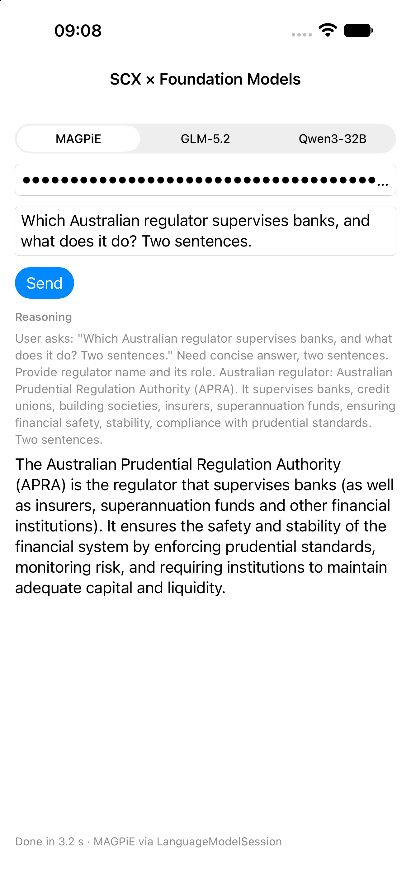

# SCXSwiftKit

SCX.ai models for Apple's Foundation Models framework. Keep the `LanguageModelSession`
code you already have, change the model, and your app's AI runs on SCX.ai's hosted models,
with MAGPiE served from Australia.

```swift
import FoundationModels
import SCXSwiftKit

let model = try await SCXLanguageModel.load(model: "MAGPiE", apiKey: key)
// before: let session = LanguageModelSession()
let session = LanguageModelSession(model: model)
let answer = try await session.respond(to: "What does APRA do?")
```

## Why this package

- **Nothing new to learn.** You keep using Apple's API: `LanguageModelSession`, `@Generable`,
  `Tool`, streaming snapshots. The package sits behind that API as a provider, so the only
  SCX-specific line in your app is the one that creates the model.
- **One codebase, on-device or hosted.** The same session code runs on Apple's on-device model
  or on SCX. Choose per session, for example the on-device model for short private tasks and
  MAGPiE's 131k context for long documents.
- **Every SCX text model, including the ones that do not exist yet.** Capabilities come from
  SCX's `/v1/models` at runtime, so a model SCX adds next month works with no package update.
- **The hard parts are done.** Streaming, tool calling, structured output, reasoning levels and
  token usage all reach Apple's channels. SCX errors arrive as Apple's error types wherever one
  fits, so your existing error handling keeps working.
- **Known to work as written.** Every pull request runs the test suite on an iOS 27 simulator
  against the live `api.scx.ai`. The examples below come from those tests.
- **Nothing else to install.** Foundation and URLSession only. MIT licensed.

## Install

Needs Xcode 27. In your app project:

1. **File** > **Add Package Dependencies**
2. Paste `https://github.com/SouthernCrossAI/SCXSwiftKit` into the search field
3. Leave the dependency rule on **Up to Next Major Version**, starting from `1.0.0`
4. **Add Package**
5. Add the **SCXSwiftKit** product to your app target

Then import it next to Apple's framework:

```swift
import FoundationModels
import SCXSwiftKit
```

To depend on it from another Swift package, add it to `Package.swift`:

```swift
dependencies: [
    .package(url: "https://github.com/SouthernCrossAI/SCXSwiftKit", from: "1.0.0"),
],
targets: [
    .target(name: "YourTarget", dependencies: [
        .product(name: "SCXSwiftKit", package: "SCXSwiftKit"),
    ]),
]
```

## What works

| Feature | Status |
|---------|--------|
| Text responses and streaming | Yes |
| Tool calling | Yes, standard Foundation Models `Tool`s |
| Structured output (`@Generable`) | Yes. SCX runs schemas with `strict: false`, so validate on the app side for critical paths |
| Reasoning levels | Yes, `light` / `moderate` / `deep` map to SCX's `low` / `medium` / `high` |
| Token usage (prompt, completion, cached, reasoning) | Yes |
| Any SCX text model | Yes, resolved at runtime from `/v1/models` |
| Image input (vision) | Yes, on models SCX lists with image input. Sent as JPEG or PNG, up to 20 MB |
| Video input | Yes, MP4 up to 300 KB, on models SCX lists with video input. Needs iOS 27.2 and Xcode 27.2 |
| Reproducible output (`seed`) | Sent, but not supported by SCX; do not rely on it |
| Device attestation (App Attest) | No. Needs a verification endpoint on SCX's side |

## Usage

Everything below is verified live against `api.scx.ai` on the iOS 27 simulator on every pull
request (GitHub Actions, Xcode 27 image) and on every run of `Scripts/ci.sh` (`Tests/SCXSwiftKitTests`).

**Streaming**

```swift
for try await snapshot in session.streamResponse(to: "Tell me about the Reserve Bank.") {
    text = snapshot.content
}
```

**Structured output**: `@Generable` schemas map to SCX's `json_schema` response format:

```swift
@Generable
struct Regulator {
    let name: String
    let acronym: String
    let supervises: [String]
}

let regulator = try await session.respond(
    to: "Which Australian regulator supervises banks?",
    generating: Regulator.self
).content
```

**Tool calling**: standard Foundation Models tools, mapped to OpenAI-style functions:

```swift
struct WeatherTool: Tool {
    let name = "getWeather"
    let description = "Current weather for a city"

    @Generable
    struct Arguments { let city: String }

    func call(arguments: Arguments) async throws -> String {
        try await weatherService.current(in: arguments.city)
    }
}

let session = LanguageModelSession(model: model, tools: [WeatherTool()])
```

**Reasoning**: reasoning models stream their reasoning separately from the answer, and
`ContextOptions.reasoningLevel` maps to SCX's `reasoning_effort`. Reasoning entries appear
in the session transcript as usual. Leave `GenerationOptions.maximumResponseTokens` unset on
reasoning models, or set it well above the expected reasoning length: SCX counts reasoning
tokens against `max_tokens` and emits them first, so a tight cap returns an empty answer.

**Images and video**: attach them with Apple's `Attachment`. Create the model with `load`, which
reads what the model accepts from `/v1/models`:

```swift
let model = try await SCXLanguageModel.load(model: "GLM-5.3-Flash", apiKey: key)
let answer = try await LanguageModelSession(model: model).respond {
    "What is in this photo?"
    Attachment(cgImage) // or Attachment(imageURL: fileURL)
}
```

Video needs iOS 27.2, the release where Apple added data attachments:

```swift
let model = try await SCXLanguageModel.load(model: "Kimi-K3.1-Pro", apiKey: key)
let answer = try await LanguageModelSession(model: model).respond {
    "What happens in this clip?"
    Attachment(SCXVideo(mp4: data))
}
```

An image above `maximumImageBytes` (20 MB by default) or a video above `maximumVideoBytes` (300 KB
by default) is refused before any upload, with `LanguageModelError.unsupportedTranscriptContent`.
300 KB is SCX's video limit for now, and a phone records more than that in one second, so export
clips at a small size first. The demo app does this with `AVAssetExportSession`: it keeps the first
15 seconds of the picture, drops the sound and sets `fileLengthLimit` to 270 KB, because that limit
is only a target for the encoder. SCX can also refuse a smaller file, and that reaches the app as
the same error with the size and SCX's message in its description. Each turn sends the attachments
of the whole conversation again, so large files are uploaded on every turn. The live tests of video
through the session need iOS 27.2 and skip on older systems.

**Timeouts**: deep reasoning can stay silent for minutes before the first token;
the allowed silence between deltas is configurable: `SCXLanguageModel(model:apiKey:timeout:)`,
or set `timeout` on the model that `load` returns. The default is 300 seconds.

**Errors**: rate limits, overload and a temporarily unavailable upstream map to
`LanguageModelError.rateLimited` (with the
retry date when SCX sends one), oversized requests to `.contextSizeExceeded`, guardrail
filtering to `.guardrailViolation`, network timeouts to `.timeout`. Other
connectivity failures (offline, connection lost mid-stream) surface as `URLError`, since
Apple's error type has no case for them. Anything else the error
type cannot express (bad key, out of credit, no permission) surfaces as `SCXError` with
SCX's own message, status and error code. Provider behaviour details live in
[docs/PROVIDER-NOTES.md](docs/PROVIDER-NOTES.md).

## Models

MAGPiE is the default. Any model id from SCX's catalogue works; `load` reads the model's
capabilities from `/v1/models`, so new SCX models need no package update:

```swift
let model = try await SCXLanguageModel.load(model: "Kimi-K3", apiKey: key)
```

`load` throws when the id is unknown to your key, when your account's tier has no region for
it, and when the id belongs to one of SCX's image, video, audio, embedding or moderation
models, which share the catalogue but cannot serve chat.

Where a model runs matters for data residency. MAGPiE is served from Australia; the catalogue
also carries models hosted in the United States, Germany and Singapore. SCX's models page lists
the regions of each model. `SCXClient(apiKey:).models()` gives them as `regions` country codes
when `/v1/models` includes them, and the list is empty when it does not.

## API key handling

Pass the key into `SCXLanguageModel(model:apiKey:)` from the Keychain or from your own
backend. Do not hardcode it: anything embedded in an app bundle can be extracted. Device
attestation (App Attest) would need a verification endpoint on SCX's side, which the API does
not provide.

## Requirements

iOS 27, macOS 27, visionOS 27 or watchOS 27 at runtime, and Xcode 27 to use the Foundation
Models surface. On older toolchains the package still builds: the provider compiles out
(`canImport(FoundationModels, _version: 2)`) and `SCXRuntime`, the plain OpenAI-compatible
client, remains usable. An app that still supports iOS 26 can therefore adopt the package and
gate usage with `if #available(iOS 27, *)`.

The package contains three targets: `SCXSwiftKit` (the `LanguageModel` conformance),
`SCXRuntime` (the client, macOS 26+, no Foundation Models dependency) and `scx-chat`, a
command line streaming demo: `swift run scx-chat --model MAGPiE "G'day"`, or
`swift run scx-chat --models` to list the catalogue with regions and capabilities.

## Demo

`Demo/` is a SwiftUI app for iOS 27 with a model picker, streamed answers, the model's reasoning
and an image or video from the photo library. Generate the project with
`cd Demo && xcodegen generate`, build for an iOS 27 simulator, and paste an API key into the app.

Images work on the simulator. Video needs iOS 27.2, and the app converts each video to a small MP4
before sending it, which the iOS 27.0 simulator cannot do. The conversion keeps the first 15
seconds of the picture at a low quality and drops the sound, so it fits in 300 KB. Test video on a
real iPhone. The phone needs Developer Mode on, and Xcode needs your Apple account:

```sh
cd Demo && xcodegen generate
xcodebuild build -project SCXDemo.xcodeproj -scheme SCXDemo \
  -destination 'id=<device id>' -derivedDataPath build -allowProvisioningUpdates \
  DEVELOPMENT_TEAM=<team id> CODE_SIGN_STYLE=Automatic CODE_SIGNING_ALLOWED=YES \
  CODE_SIGN_IDENTITY="Apple Development" PRODUCT_BUNDLE_IDENTIFIER=<your bundle id>
xcrun devicectl device install app --device <device id> \
  build/Build/Products/Debug-iphoneos/SCXDemo.app
```

`xcrun devicectl list devices` shows the device id.



## Contributing

Contributions are welcome, from SCX's own engineers and from anyone else. Setup, running the
tests and the pull request workflow are in [CONTRIBUTING.md](CONTRIBUTING.md).

## License

MIT, see [LICENSE](LICENSE).
